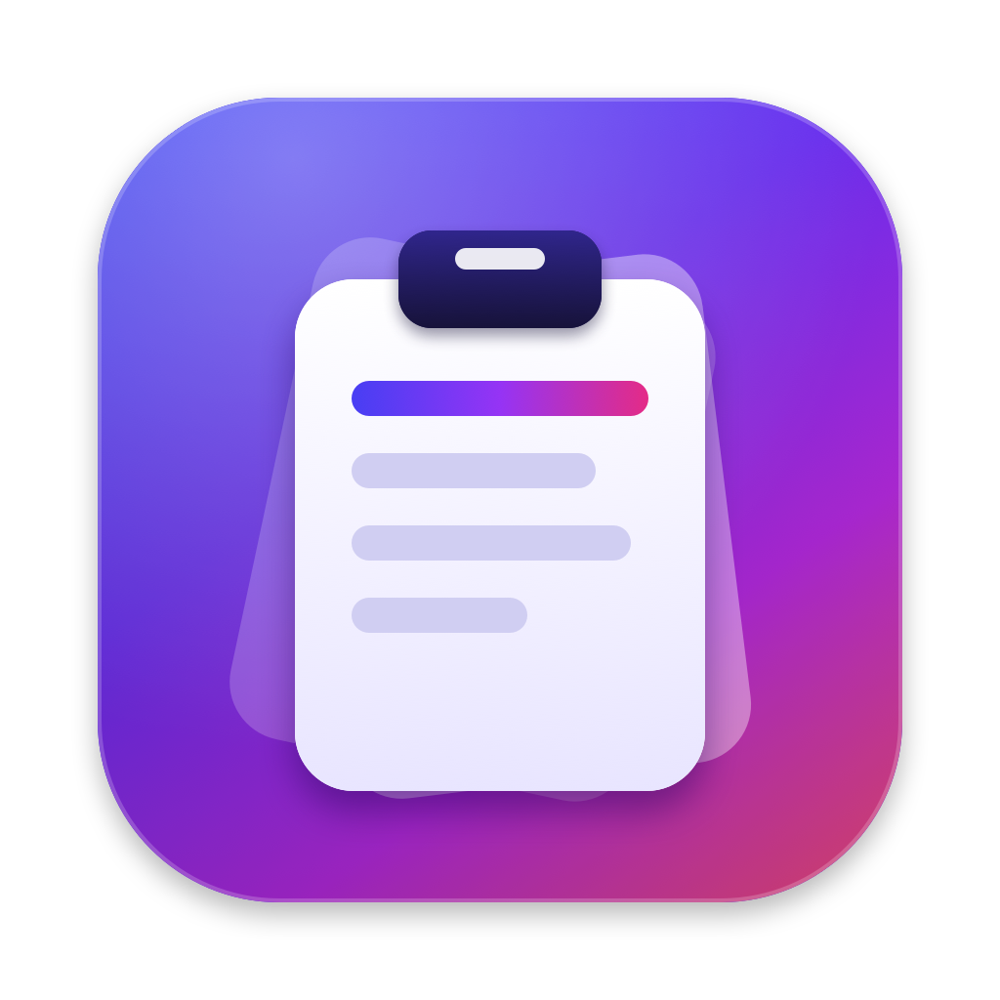
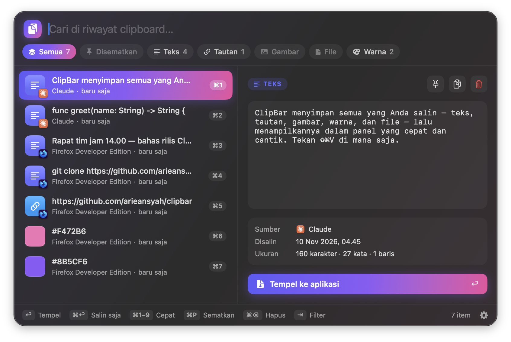

<p align="center">
  
</p>

<h1 align="center">ClipBar</h1>

<p align="center">
  Pengelola clipboard untuk macOS yang cepat, cantik, dan privat.<br>
  Tekan <kbd>⇧⌘V</kbd> di mana saja untuk membuka riwayat clipboard Anda.
</p>

<p align="center">
  
  
  
</p>

<p align="center">
  
</p>

## Fitur

- **Riwayat lengkap**: teks, tautan, gambar, file, dan kode warna (`#8B5CF6`) dikenali otomatis.
- **Panel ala Spotlight**: muncul di tengah layar lewat <kbd>⇧⌘V</kbd> atau di bawah ikon menu bar.
- **Pencarian instan**: ketik untuk menyaring, atau pilih filter Semua / Disematkan / Teks / Tautan / Gambar / File / Warna.
- **Pratinjau kaya**: teks monospace, gambar besar, swatch warna dengan nilai HEX / RGB / HSB, daftar file dengan tombol *Tampilkan di Finder*.
- **Tempel otomatis**: pilih item dan ClipBar langsung menempelkannya ke aplikasi yang sedang aktif.
- **Sematkan**: item penting tetap di atas dan tidak pernah terhapus otomatis.
- **Privat**: data dari pengelola kata sandi (1Password, Bitwarden, Passwords, Keychain) dan tipe `org.nspasteboard.ConcealedType` / `TransientType` tidak pernah disimpan. Semua data hanya ada di Mac Anda.
- **Pengaturan**: buka saat login, pilihan pintasan (⇧⌘V, ⌥⌘V, ⌃⌘V, ⌃⌥V), batas riwayat, jeda pemantauan.
- **URL scheme**: `clipbar://open`, `clipbar://settings`, `clipbar://pause`, `clipbar://resume` untuk Shortcuts, Raycast, atau Alfred.

## Pintasan keyboard

| Tombol | Aksi |
| --- | --- |
| <kbd>⇧⌘V</kbd> | Buka / tutup ClipBar (bisa diganti di Pengaturan) |
| <kbd>↑</kbd> <kbd>↓</kbd> | Pindah item |
| <kbd>↩</kbd> | Tempel item terpilih |
| <kbd>⌘↩</kbd> | Salin ke clipboard saja, tanpa menempel |
| <kbd>⌘1</kbd>–<kbd>⌘9</kbd> | Tempel item ke-1 sampai ke-9 |
| <kbd>⌘P</kbd> | Sematkan / lepas sematan |
| <kbd>⌘⌫</kbd> | Hapus item |
| <kbd>⇥</kbd> / <kbd>⇧⇥</kbd> | Filter berikutnya / sebelumnya |
| <kbd>⌘,</kbd> | Pengaturan |
| <kbd>esc</kbd> | Hapus pencarian / tutup panel |

Klik kanan ikon menu bar untuk menu cepat (jeda, hapus riwayat, pengaturan, keluar).

## Instalasi

Butuh macOS 13 atau lebih baru dan Xcode (atau Command Line Tools) dengan Swift 5.9+.

```bash
git clone https://github.com/arieansyah/clipbar.git
cd clipbar
./scripts/install.sh
```

Script tersebut akan:

1. membuat ikon (`Resources/AppIcon.icns`) bila belum ada,
2. meng-compile dengan `swift build -c release`,
3. menyusun `ClipBar.app` dan menandatanganinya secara ad-hoc,
4. memasangnya ke `/Applications` lalu menjalankannya.

Hanya ingin build tanpa memasang? Jalankan `./scripts/build.sh`; hasilnya ada di `build/ClipBar.app`.

### Izin Aksesibilitas

Fitur **tempel otomatis** perlu menekan <kbd>⌘V</kbd> atas nama Anda, sehingga macOS akan meminta izin di
**System Settings → Privacy & Security → Accessibility**. Tanpa izin ini ClipBar tetap bekerja: item disalin ke clipboard dan Anda tinggal menekan <kbd>⌘V</kbd> sendiri.

> Karena build ditandatangani secara ad-hoc, macOS menganggap setiap build baru sebagai aplikasi berbeda.
> Setelah build ulang, hapus ClipBar dari daftar Accessibility lalu tambahkan lagi.

## Struktur proyek

```
Sources/ClipBar/
├── main.swift              # entry point (NSApplication, mode accessory)
├── AppDelegate.swift       # ikon menu bar, menu, URL scheme
├── ClipboardWatcher.swift  # memantau NSPasteboard, filter privasi
├── ClipStore.swift         # riwayat + persistensi JSON & gambar
├── ClipItem.swift          # model data & filter
├── PanelController.swift   # NSPanel non-activating + navigasi keyboard
├── PanelView.swift         # UI SwiftUI: pencarian, filter, daftar
├── PreviewPane.swift       # pratinjau teks/tautan/warna/gambar/file
├── SettingsView.swift      # jendela pengaturan
├── HotKey.swift            # pintasan global (Carbon)
├── Paster.swift            # kirim ⌘V via CGEvent
└── Components.swift        # komponen UI & helper
Tools/make_icon.swift       # menggambar ikon aplikasi secara programatis
scripts/                    # build.sh, install.sh, make_icon.sh
```

Data tersimpan di `~/Library/Application Support/ClipBar/` (`clips.json` + folder `Images/`).

## Kontribusi

Pull request dan issue sangat diterima. Untuk perubahan besar, buka issue dulu agar bisa didiskusikan.

1. Fork repo ini
2. Buat branch: `git checkout -b fitur/nama-fitur`
3. Commit perubahan Anda
4. Buka pull request

## Lisensi

[MIT](LICENSE)
